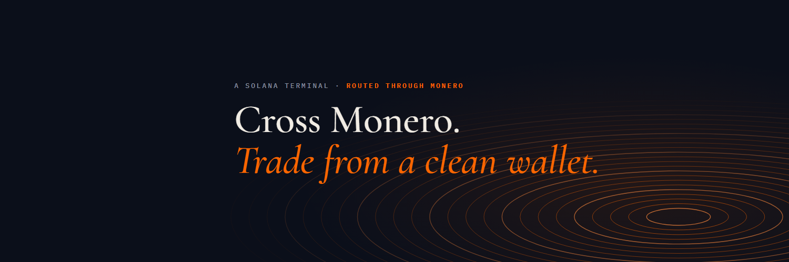

<p align="center">
  
</p>

<p align="center">
  <b>Arm a clean wallet through Monero. Fire private buys on Solana instantly.</b><br>
  A full trading terminal sits around it. Non-custodial, open source, and proven on-chain.
</p>

<p align="center">
   <b>SOL</b> &nbsp;→&nbsp;
   <b>XMR</b> &nbsp;→&nbsp;
   <b>SOL</b>
</p>

<p align="center">
  <a href="https://github.com/JermWang/ArdeaFinance/actions/workflows/test.yml"></a>
  <a href="https://ardeafinance.xyz/proof"></a>
  <a href="https://ardeafinance.xyz"></a>
  <a href="https://x.com/Ardeafinance"></a>
  
  
</p>

<p align="center">
  <a href="https://ardeafinance.xyz">Website</a> ·
  <a href="https://ardeafinance.xyz/app.html">Arm a wallet</a> ·
  <a href="https://ardeafinance.xyz/proof"><b>Proof</b></a> ·
  <a href="https://ardeafinance.xyz/track.html">Route tracker</a> ·
  <a href="https://ardeafinance.xyz/docs.html">Docs</a> ·
  <a href="https://x.com/Ardeafinance">X @Ardeafinance</a>
</p>

---

## Why

Every Solana wallet is a public ledger. Trackers link wallets by following SOL: whoever funds a wallet is assumed to
own it, and a fresh wallet stops being fresh the moment you top it up. Ardea breaks that link by never sending SOL from
your wallet to the wallet that buys. The SOL crosses **Monero** first.

## Arm a wallet

A private route through Monero takes 10–40 minutes (sometimes about an hour), too slow for a coin that's moving. So
Ardea does the slow part first.

1. **Arm.** Choose a total and one to five wallets. The total is split into uneven, non-round sizes, and each fresh
   wallet gets its own Monero route. You approve every funding transfer in one wallet prompt; they go out at random
   3–15 second intervals.
2. **Wait once.** Each route crosses Monero in the background. When a wallet's SOL lands, it's **armed**.
3. **Fire.** With Private mode on, any buy or ⚡ quick-buy fires the oldest armed wallet instantly with its whole
   balance, signed in your tab. No popup, no route to wait for.
4. **Disarm.** Send a wallet's SOL, or what's left after selling, back to you through the same Monero route.

Because the funding happens earlier, at uneven sizes and random times, the buy's timing and amount don't line up
with your deposit, the match trackers look for.

## How a route works

```
your wallet ──SOL──▶ one-time deposit address (exchange A) ──▶ XMR on Monero ──▶ exchange B ──SOL──▶ fresh wallet
   (signs one plain transfer)       SOL → XMR            ring signatures,       XMR → SOL      (buys on Jupiter)
                                                         stealth addresses,
                                                         RingCT
```

- **Monero is forced on every route** (`useXmr=true`, Houdini Swap private send). If no Monero route is available,
  nothing is sent; there is no other path.
- **Every order is checked before you sign** (`checkOrder` in [`stealth.js`](stealth.js)): it must pay exactly the
  fresh wallet, swap SOL to SOL on Solana, be a private route, keep the amount, use a deposit address that isn't one of
  yours, need no memo, and not be about to expire. Anything else is refused.
- **The fee rides inside the route.** Ardea's 0.5% is Houdini partner markup (0.25% on each leg), so your funding is
  one plain transfer to a one-time address with nothing pointing at Ardea. If no route can carry the fee, or the only
  one is much slower, the route runs fee-free rather than block you or add a fee transfer.
- **Fastest fair route.** The terminal takes the fastest route paying within 2% of the best payout.
- **Recoverable anywhere.** Stealth and armed wallets are derived from one signature of your wallet
  (SHA-256 of signature ‖ `ardea/stealth/i`), so signing again on any device rebuilds them. Nothing secret is stored.

## Proof

Ardea runs two proof wallets of its own and sends SOL between them on a schedule, through the same code path a private
buy uses. Each completed route is matched to Houdini's own record and to the Solana transactions it produced.

| Houdini route | Direction | SOL in → out | Took | Funding tx | Delivery tx |
|---|---|---|---|---|---|
| `4QF9jP9Zuz7LkMtPfXRivC` | Proof A → Proof B | 0.3 → 0.2975 | 81 min | [3LkACAvZ…](https://solscan.io/tx/3LkACAvZPxHE2vRzjqgWzkZCvBKhK3wFBKjqhfEFej3i9Lxo2AZepp7SAQLcoWymhQqdBcXVXxXpqDQa5FgzVNQA) | [4mD881oW…](https://solscan.io/tx/4mD881oW7k7KX6SpRS3ZQKM2kN4JLPC3qYwMgeUrG7ABpFGcSRovgYNj9roCR7QNksgP4zMoJdv2FjdxVdUd7NU) |
| `pgAKKLNz88tJ4vCn33simc` | Proof B → Proof A | 0.2875 → 0.2723 | 6 min | [LrUKVmwX…](https://solscan.io/tx/LrUKVmwXXwhzokx388F1MQTQxQuhBAjZh7LLzAebatxDPzyHj4R1YrZJMfitGuz1DZC5WmgG9CKnrQhMUSD1BLm) | [2kpNyg8F…](https://solscan.io/tx/2kpNyg8FkvKwvUfpF2LEM4mZnHH8C8Et4gMVzJC6GrwWz3vFnNUdokEMz76xisqWLx38cdrfA7mMCoMbQdKZNAMu) |

**Every route, with its Houdini record and how to check it: [PROOF.md](PROOF.md).** The always-current list is at
[ardeafinance.xyz/proof](https://ardeafinance.xyz/proof) (plain HTML) and [`/proof.json`](https://ardeafinance.xyz/proof.json).

**Check a route yourself:**

1. **Funding.** The sending proof wallet pays the route's one-time deposit address, and nothing else: no transfer to
   Ardea, none to the other proof wallet.
2. **Delivery.** The receiving proof wallet is paid by an exchange's wallet, never by the other proof wallet.
3. **The match.** `https://ardeafinance.xyz/proof/route/<route id>.json` returns Houdini's own order record: its
   `inHash` is the funding transaction, its `transactionHash` the delivery, `anonymous: true` marks Houdini's private
   two-exchange route, and `status: 4` means finished.
4. **No shortcut.** Proof wallets [`3WfKw8…zYjy`](https://solscan.io/account/3WfKw8HJENLS42DEdVHvh7LoXMSC6Uuay4BcF9akzYjy)
   and [`7TLWpu…GBeK`](https://solscan.io/account/7TLWpuaZrBxsu1sSCeHRZQDNfVYe2gtHCfM1A5JvGBeK) never transact with
   each other directly.
5. **Monero.** Houdini's record doesn't name the middle asset; Monero is what Ardea requests on every route
   (`useXmr=true`, covered by tests). Houdini support confirmed the first route was waiting for 20 Monero network
   confirmations at the second exchange, which is why it took 81 minutes.

The proof job is [`proof.mjs`](proof.mjs); the page is [`proofpage.mjs`](proofpage.mjs). The proof wallets are only
proof wallets: fees go to a separate, receive-only treasury.

## What it doesn't hide

Houdini sees both ends of each route (it keeps order data for about 72 hours) and each exchange sees its own leg. A
determined observer can still try to match amounts and timing. Arming ahead at uneven sizes, the route's fees and the
random timing make that harder; they can't make it impossible. An armed wallet's key lives in your browser, derived
from your signature, so keep in it only what you mean to trade.

## The terminal

- **Pulse:** new pairs, final stretch and migrated tokens, streamed live from PumpPortal with bonding-curve progress
  read from the chain, holders, dev share, volume and buy/sell counts, and ⚡ one-click buys.
- **Trending, token pages, tracker, limit orders, portfolio and PnL,** with Jupiter routing and P1–P3 presets.
- **Instant wallet:** trade with no popups from a wallet derived from one signature; fund it directly or through Monero.
- **Trail audit:** in Portfolio, see what trackers can already link to your wallet.
- **Route tracker:** `ardeafinance.xyz/track.html#<route id>` follows any route live from its link alone.
- **Holder fee tiers:** holding the token lowers the fee (0.1% / 0.5% / 1% of supply → 0.4% / 0.3% / 0.25%).

## Security model

- **Non-custodial.** Every transaction is built in your browser and signed by your wallet or by a key derived from your
  own signature. No Ardea server holds funds, wallet keys or orders.
- **The gateway only forwards.** [`server.mjs`](server.mjs) serves the site and forwards RPC, Jupiter, Houdini and Jito
  requests with the API keys, which live only in server environment variables. It never signs anything and doesn't log
  which wallets you look up.
- **Readable code.** Plain HTML and ES modules, no build step: what's in this repo is what the site serves.

## Repository layout

| Path | What it is |
|---|---|
| [`stealth.js`](stealth.js) | Stealth wallets, the Houdini client, route selection, order checks, funding and exit transactions |
| [`armory.js`](armory.js) | Arm a wallet: wallet sizes, which armed wallet fires next |
| [`terminal.js`](terminal.js), [`app.html`](app.html) | The terminal: Arm screen, Pulse, token pages, trading, portfolio |
| [`proof.mjs`](proof.mjs), [`proofpage.mjs`](proofpage.mjs) | The proof routes and the `/proof` page |
| [`track.html`](track.html), [`trackview.js`](trackview.js) | The route tracker |
| [`tiers.js`](tiers.js) | Holder fee tiers |
| [`server.mjs`](server.mjs), [`worker/src/index.js`](worker/src/index.js) | Static files and the API gateway |
| [`test/`](test) | 80+ tests, run on every push |

## Run and test

```bash
npm ci
npm test
node server.mjs
```

## Deploy

Railway service **ardea**: `railway up --service ardea --detach`. Variables: `RPC_URL`, `RPC_WS_URL`, `JUP_API_KEY`,
`HOUDINI_API_KEY`, `HOUDINI_API_SECRET`, `ALLOWED_ORIGINS`, `TOKEN_CA`, and for the proof routes `PROOF_WALLET_SECRET`
(plus optional `PROOF_INTERVAL_HOURS`). Every saved variable redeploys, so set them in one save.
